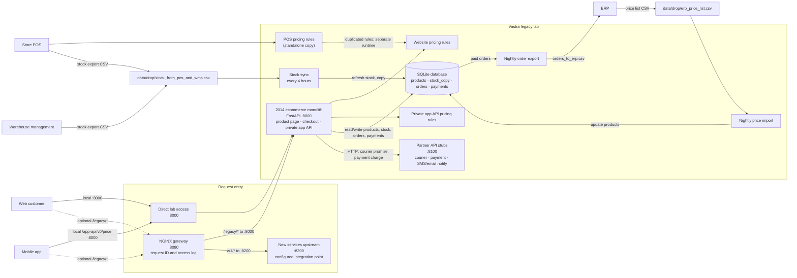

# Vastra legacy lab architecture

This diagram describes the runnable legacy lab. The NGINX routes are shown separately because they are configured in `../gateway/nginx.conf` for S2; the local run instructions start the monolith and partner stubs directly. The `/v1/` upstream is a configured integration point, not a service implemented in this lab.

## Runtime and data notes

- The local database is SQLite at `data/vastra_legacy.db`; it stands in for the legacy MySQL database.
- The monolith calls the courier and payment stub APIs during checkout. The stubs also expose a notification endpoint.
- POS pricing is a separate implementation; it is not served by the monolith.
- The stock and price jobs import CSV files into the database. The order job exports paid orders to a CSV for the ERP.
- The local startup instructions bypass NGINX. When used, the gateway sends `/legacy/*` traffic to the monolith and `/v1/*` traffic to the configured new-services upstream.
